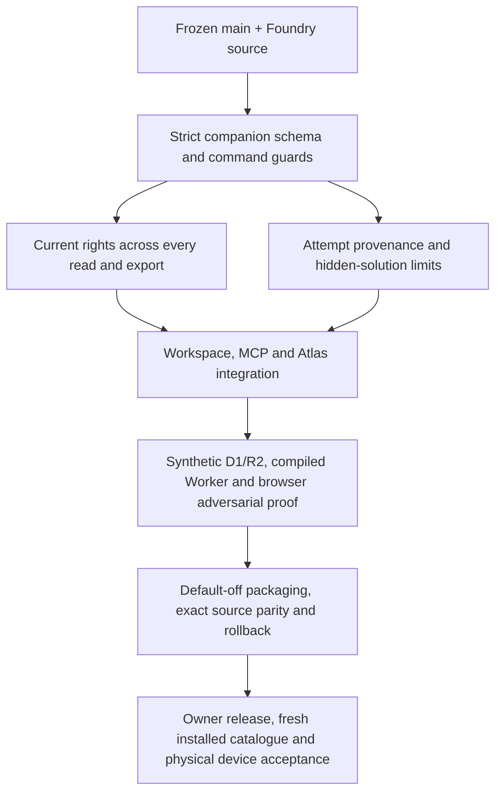

# Independent initial security, runtime and release audit

This is the initial source audit, before Activity Studio implementation. It is not a readiness certification. Companion fields on existing experiment/run records are viable only if they enter the same shared admission, projection, command, history and recovery paths. An endpoint-only validator would leave generic web/MCP commands as bypasses.

The science runtime already uses an opaque script-only iframe and a terminating blob Worker with deny-network CSP. This should be preserved; an arbitrary JavaScript preview requires its own independently proven isolation and should remain a local handoff otherwise. Rendering a supplied terminal transcript never establishes execution.

The key unresolved code checks are current rights on new nested content, default-off behavior through generic commands, solution/hint leakage through ordinary reads, immutable target editions, and typed output provenance. Their concrete baseline locations and acceptance tests are recorded in INITIAL-GAP-LEDGER.json. Later review must update status from actual tests, not infer safety from this design.

GitHub source and native Sites source have separate histories. A draft PR or GitHub merge cannot establish deployment. This commission permits no Site source save/deploy or production catalogue refresh, so those remain explicit future owner release gates.
