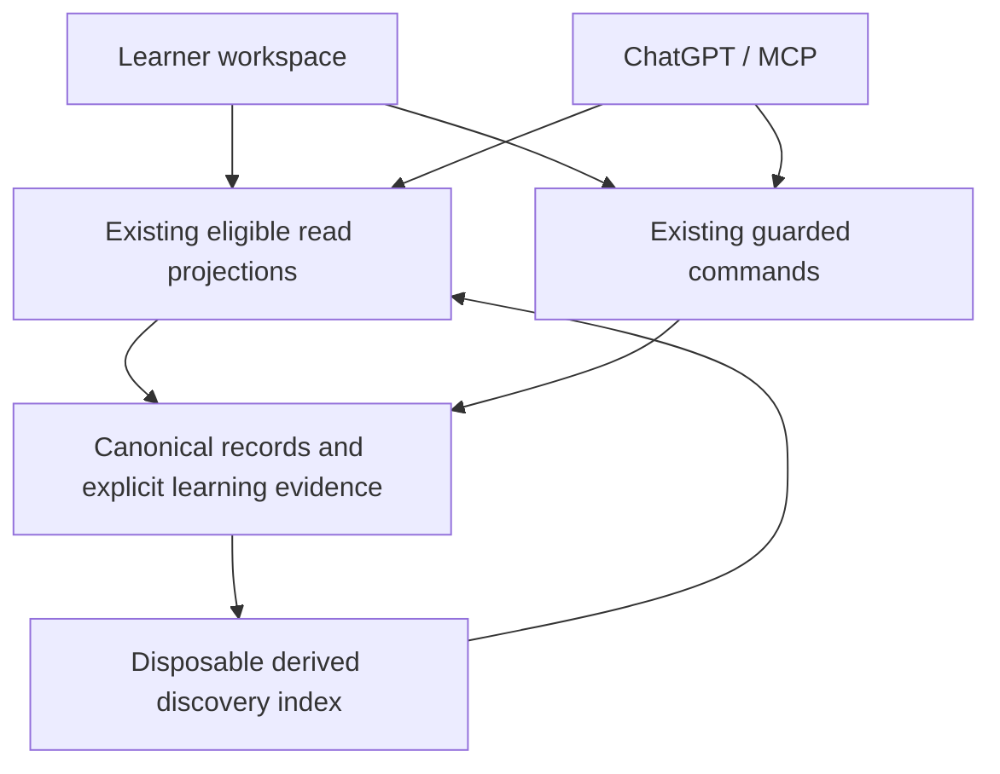

# Integrated implementation design

**PR27 synthesis · 23 October 2026 · proposed implementation scope.** This document reconciles the original request, the [initial exploration](INITIAL-EXPLORATION.md), the [UX extension](UX-UI-AND-LIBRARY-GROWTH.md), current source and focused experiments. It supersedes the earlier lists for scope and sequencing. The earlier findings remain useful evidence and alternatives; they are not cumulative instructions to build every idea.

This task develops an implementable design and research artifacts. It does not claim that the changes below are released. The existing private V21, native source and genuine learner records remain unchanged. A later execution request can use this selected scope without restarting a broad assessment. The [focused product and learning-quality challenge](FOCUSED-CHALLENGE.md) refines this plan; its experiments are evidence, not an extra feature backlog.

## 1. The synthesis: three outcomes, one product change

The original request concerned a complete learning workflow across ChatGPT, MCP, Minamo, real computing environments and GitHub. The first draft concentrated on durable evidence, retrieval and authoring. The UX extension exposed how difficult it can still be to reach and use those capabilities. These are complementary parts of the same problem.

The first implementation should deliver three complete outcomes:

| Outcome | What changes together | What success looks like |
| --- | --- | --- |
| **Find and use a useful reference** | Subject hubs, useful collection summaries, clearer technical lookup, exact destinations, reference preview, dependable return | A learner finds an independently useful explanation, uses it from a practical task and returns without losing position or writing |
| **Do practical work, retain reasoning and resume** | Focused Journey stages, question-led Investigation layout, existing Notes/checkpoint presentation, quiet GPT handoff, honest browser practice | The learner and a future GPT recover the actual attempt, reason for a choice, evidence limits and next useful experiment |
| **Create, reuse and revise independent knowledge** | Natural manuscript authoring retained; better mechanical linking/indexing and presentation coordination; targeted revision and realistic teaching evaluation | A future ordinary request produces useful independent material, a second task reuses it, and a correction preserves exact captures and personal work |

Modern visual design, reading settings, accessibility, fast reads and reliable saves support all three. They are not an optional polish phase after “backend completion”. Equally, a more attractive screen does not compensate for missing reasoning or a thin Article.

### Traceability to the owner's goals

| Goal from the requests | Selected implementation response |
| --- | --- |
| Rich future resources through normal GPT/MCP interaction | Preserve Markdown-first authoring, small optional catalogue declarations and direct guarded publication; strengthen reuse/revision and realistic educational evaluation |
| Strong Library depth, growth and organisation | Curated Area hubs over existing Articles; meaningful summaries and references; grow coverage through reuse/deepening rather than article-per-stage duplication |
| Meaningful self-study and practical routes | Focused stage, accessible reference preview, clear Investigation guide versus saved work, persistent Notes |
| GPT continuity across conversations | Reuse current tutor context and explicit Developments; expose exact chosen handoff; preserve choices, reasons and next action |
| Kali/Windows/mobile and GitHub artifacts | Label environment and evidence honestly; improve exact links/Notes first; no compulsory new local agent or direct Site GitHub connection |
| Modern, satisfying and seamless interaction | Shared presentation state, truthful pending/saved states, focus/Back/position continuity, a smaller coherent shell and local comfort settings |
| Appropriate server/GPT division | Server owns identity, eligibility, indexing, parsing and receipts; GPT owns explanation, diagnosis, semantic relevance and educational judgement |
| Free, private and recoverable | Existing infrastructure/dependencies, no paid AI/API; preserve all guarded writes/rights/recovery; disposable experiments contain synthetic data only |

## 2. Decisions that reconcile the drafts

| Earlier possibility | Decision for the selected scope | Why |
| --- | --- | --- |
| A second interactive Reader beside the task | **Reference preview first**, full exact reading on demand | Rendering two current Readers reproduced four duplicate DOM IDs. Full dual annotation needs scoped IDs, selection and listeners, not just a CSS panel |
| A new workspace-context API | **Reuse current task/tutor and exact context reads** | Existing `get_minamo_learning_context(profile:tutor)` already composes the task, saved reasoning, related work and deferred details |
| Library hubs / a new Topic hierarchy | **Curate existing Areas and links** | Existing Area sections and catalogue memberships can serve the first version; extra taxonomy would add authoring/migration burden |
| Synced preferences | **Device-local presentation settings first** | Cloud preferences require explicit ownership, generation and recovery semantics; they do not justify a new durable store yet |
| FTS5/BM25 | **Conditional FTS candidates with corpus-independent ranking** | Local evidence supports lexical matching, but global BM25 ordering is affected by excluded owners/generations |
| Broad semantic/OR search | **No automatic broad-answer mode** | OR increased recall and irrelevant candidates. Preserve exact lookup and GPT's thoughtful reformulation; no paid embeddings or PR12 revival |
| Practical attempt record/helper | **Existing Note revisions and Development facts/decisions** | Already represent the needed evidence; a new session/attempt family or daemon would duplicate authority |
| Long-term continuity as a new memory store | **Repair existing chronology/coverage and reuse eligible saved perspective** | Current tutor reads are economical but history can be mislabelled and older rationale omitted; existing explicit Developments/perspective provide the authority |
| Personal rediscovery only through loaded results | **Complete bounded personal query within the existing domain** | A context-linked Note beyond the loaded page must remain discoverable; keep private writing separate from Article FTS |
| Generic reveal / active-learning widget | **Author purposeful optional reasoning with current blocks first** | Current content has no explicit question/answer pairing; arbitrary hiding could conceal qualifications or exact targets |
| More quality validation | **Better development evaluation and GPT review** | A plausible factual error passed structural validation as advertised. More schema/mandatory previews would not establish teaching quality |
| Direct GitHub, offline packs, new JS engine, OCR | **Deferred with explicit triggers** | Useful possibilities, but not dependencies of the three outcomes and not yet justified by simpler-path failure |

Do not read “conditional” as “leave the design vague”. The retrieval adoption gate and deferred-feature triggers below specify exactly what evidence is still needed.

## 3. Architecture and state ownership

Retain React/Vinext, Worker, D1/R2, shared domain validation, canonical reading and existing web/MCP commands. No new UI framework, global state library, content store or inference service is required.

The index supplies candidates; it never grants read authority. Local presentation state is separate from all durable learning evidence.

### Presentation state

Add a small typed coordinator, extracted from the current workspace rather than a second router:

- primary destination: existing family/id, optional rendition/stage/selection;
- optional reference destination, with a distinct identity;
- Library view/filter and scroll restoration associated with the history entry;
- open overlay/focus-return target and pending-read status;
- device-local reading/layout preferences.

Keep Notes and Tools mounted under their existing owners. Do not key or reparent editors by selected Article, reference, tab label or preference. React's state preservation depends on tree identity; a visually equivalent wrapper swap can reset editor state. Preserve existing draft/editor-memory and generation fences.

Use safe typed identities in URLs. No Note text, terminal output or private question prose enters a URL. Closing a pushed reference goes Back within the primary task; a directly opened reference URL closes by replacing that reference state, not by blindly navigating out of Minamo. Back/Forward, reload and opening a link in another tab are acceptance cases.

The reference does not silently become the learning target. “Note on this stage” and “Note on this reference” select context explicitly; changing panes never retargets an existing Note. The same distinction applies to GPT handoff and capture actions.

## 4. Product changes and implementation seams

### 4.1 Shared shell and reference preview

**Modules:** `app/workspace.tsx`, `app/workspace.css`, `app/reader.tsx`, `app/reading-navigation.tsx`, `lib/record-navigation.ts`, `lib/reading-links.ts`, `app/notes-panel.tsx`; proposed small `workspace-presentation` and `reference-preview` modules.

Tighten the header/reading hierarchy while preserving the charcoal/blue token system, visible search and existing reading affordances. Use one appropriate contents treatment at a given width. Keep detailed editing/history/recovery separate from primary reading. Correct platform shortcut hints and honour reduced motion in script-driven scrolling as well as CSS.

Use a consistent hierarchy across views: Home reorients through explicitly saved work and a clearly separate recent-reading path; Library presents reusable knowledge; a Journey foregrounds a practical action; an Investigation foregrounds its open question and saved thinking; Notes retains the learner's editable voice. An empty saved-work region is not a prompt to manufacture progress. Show purpose before administrative counts, with one main heading and restrained secondary actions. Keep search, Notes, exact marks and recovery discoverable rather than removing them to reduce visual density. Provide concise contextual help for the existing Flag/Annotate selection flow, with accessible touch/keyboard alternatives; preview explains that exact capture opens the full reading.

Assess a complete task/reference/writing screen with substantial prose, code, a table and a purposeful diagram at default and enlarged text. Code/table overflow must stay inside its own surface, diagram alternatives/enlargement remain accessible, and the writing acknowledgement or failure stays visible while typing. A narrow layout is not successful merely because the outer page has no horizontal scroll. The richer prototype exposed a status message below the writing scrollport; its correction reserves a feedback row. Production must retain real Note controls and acknowledgements within the available visual viewport, including keyboard-open states. Do not copy its synthetic textarea dimensions into the real editor.

The first reference pane is a bounded, faithful preview of an eligible exact record/section: title, version, a useful explanatory part and appropriate code, with Open exact reading. It must say when the explanation contains material omitted from preview. The full rich canonical reading remains one action away; the preview is not a flattened replacement for diagrams, media or substantial teaching. Reuse an already admitted matching reading where valid, otherwise make one deliberate existing eligible read. Do not prefetch whole Articles for every card or invent a new general context endpoint. If measured transport cost warrants a preview-only HTTP projection later, share the existing domain eligibility function and preserve the normal exact read; a smaller browser panel is not a reason to shrink GPT's educational context automatically.

**Do not reuse an unchanged Reader or `RichReadingPart` blindly in the pane.** Generated canonical DOM IDs and `data-reading-*` hooks also need isolation in passive output. Either scope reusable rendering explicitly or render the preview without canonical selection hooks/global IDs. Disable annotation/Flag capture inside the preview until instance-scoped interaction is implemented and tested. Preserve native text/code copying faithfully; never turn a preview coordinate into a canonical anchor.

Allocate vertical space to writing and horizontal space to explanation. When minimum useful widths are unavailable, show the reference as a full secondary view with a dependable return rather than compressing three narrow columns. The local prototype initially pushed writing below the viewport and lost focus on close; both were corrected by stable primary DOM ownership, explicit focus return and allocated writing space. Production must apply the same principles to real Notes, resizing and the virtual keyboard, not copy the prototype layout uncritically.

### 4.2 Library hubs, cards and growth

**Modules:** `app/library-browser.tsx`, Area handling in `app/workspace.tsx`, `lib/catalogue.ts`, `lib/catalogue-command.ts`, `lib/relationship-command.ts`, `lib/manuscript.ts`.

Retain a compact Library home. A selected Area becomes a hub with its eligible introduction, a small authored set of topic groups and technical-reference entry points, plus the complete paginated member list. Use current Area sections and contextual links for curation. Where no curated groups exist, the existing member browse remains a useful fallback.

Preserve the distinction between **membership** and **contextual explanation links**. `memberSQL` excludes section/stage/pinned contextual links intentionally. An Article belongs through a separately accepted unscoped Article↔Area link; an Area section may highlight that Article for a particular reason. Do not broaden membership SQL or infer classification from every link. The current 30-link record limit makes a hub an entry map, not an enumeration of all members.

Evaluate a three-level browse presentation—Subjects, Topics, Technical reference—with visible kind filters inside technical reference. Commands must stay easy to reach. Preserve existing facets/aliases/API inputs; the UI grouping does not require a new data family. Keep subject/filter state and result position when returning from reading.

Use a shared bounded, currently eligible summary projection for collection cards. Library already prefers authored catalogue summaries and falls back to canonical prose. Generalise the safe fallback for Journeys/Investigations instead of relying only on `record.body`, which manuscript-created records often leave empty. Label an excerpt as an excerpt; do not synthesize purpose server-side or add a required summary field. Show useful purpose/context before connection/section counts.

Library growth happens through ordinary authoring requests: reuse, deepen or correct existing coverage, and create genuinely independent explanations where needed. Do not migrate/rewrite the current corpus as a prerequisite. Small synthetic authoring acceptance material should demonstrate the hub and cross-project reuse. During an ordinary creation/revision request, use compact eligible candidate summaries and exact reads to decide whether to deepen existing coverage. A title-only candidate miss is not a coverage verdict: GPT may reformulate a few purposeful searches, without a mandatory search ceremony on every turn. Surface mechanically demonstrable broken destinations or missing declared membership in the existing authoring findings when encountered. Dates/overlapping titles are review cues, not proof of outdated or duplicate teaching; GPT assesses the explanation and checks relevant authoritative sources. No automatic corpus audit, repair queue or semantic quality score is selected.

Personal rediscovery is part of this slice, independent of optional Article FTS. Extend `lib/domain.ts`'s existing bounded query, its HTTP/MCP schema and `app/personal-work-organiser.tsx` for exact context/topic filtering across eligible saved personal work, rather than only `workRows` on loaded pages. Preserve current direct, captured/display and accepted parent-context meanings; resolve them against eligible current records, not whichever parent cards happen to be loaded. Apply filters before result pagination, bind cursors to all filters/generation and retain truthful pending/empty/error states. Sorting must either be server-wide with a scoped cursor or explicitly labelled as ordering the loaded results.

A personal quotation search must match only currently permitted projected quotations; raw revoked anchor text must not influence hits, snippets or counts. Independent Note/Annotation prose remains discoverable when its source quotation is withheld. Keep personal search separate from the Article-only derived index and preserve exact historical capture destinations. Prefer a small extension of current queries over a new store. Bound internal scans/row work and expose continuation honestly if eligibility filtering exhausts a work budget; never label a partial scan “no matching work”. Verify optional query parameters in the actual installed catalogue before claiming MCP support; an unavailable installed input must have a clearly documented existing read/web fallback, not an invented successful call.

### 4.3 Journeys and Investigations

**Modules:** `app/journey-route.tsx`, `app/investigation-workspace.tsx`, `app/learning-developments.tsx`, `app/learning-home.tsx`, `lib/manuscript.ts`.

For Journey overviews, emphasise purpose, environment/starting assumptions and route. For a stage, make the first practical action and relevant reference obvious. Retain optional entry/exit, direct stage selection and stable stage identity; Next is navigation, not completion.

Coordinate metadata with canonical reading. Remove redundant **generated** heading/intent/outcome/checkpoint chrome when the same information is already represented canonically. Preserve every canonical part, visible exact target and source edition. For a single-stage reading, the canonical section heading can carry the main heading role without a second generated title. Avoid adding a second numeric ordinal where the title already supplies one. No regex stripping of canonical prose or automatic rewriting of existing titles is authorised by a presentation change. Keep metadata-only information when it has no canonical equivalent; use exact declaration matching rather than semantic guessing.

Distinguish resume from an eligible saved checkpoint and last opened on this device. Current sessionStorage stage position cannot be presented as cross-device learning persistence. Home's explicit learning projection remains authoritative for saved work.

For Investigations, arrange the question/guide, existing saved work and references as complementary views. The My work region projects existing Notes, Development facts/decisions, evidence and uncertainty; it creates no hypothesis board, confidence model or interaction log. Empty work is an honest useful state. Avoid tabs that force the learner to keep switching just to compare guide and evidence; adapt the layout to available space.

### 4.4 Notes, practical evidence and handoff

**Modules:** `app/notes-panel.tsx`, `app/gpt-handoff.tsx`, `lib/gpt-context.ts`, `lib/learning-work.ts`, `lib/learning-perspective-view.ts`, `app/tools-panel.tsx`.

Keep current rich Notes, continuous acknowledgement/conflict behaviour and docking. Add explicit reference-versus-task context to new captures, preserve existing links and make context removal deliberate. Do not introduce a second scratch/evidence store in production: the prototype scratch area tests layout only.

Use existing evidence types:

| Material | Representation |
| --- | --- |
| Supplied terminal output and environment | Original Note, exact revision; learner report or supplied-artifact basis |
| Actual saved browser tool execution | Existing immutable Run and honest runtime/fidelity; observed only under current rules |
| GitHub artifact | Exact pinned link; link-only unless bytes were actually inspected; no implication of execution |
| Diagnosis or explanation | Separately labelled GPT interpretation |
| Explicitly requested continuity | Development containing meaningful attempt/choice/reason/uncertainty/next action and exact evidence refs |

Expose the existing handoff through a quiet action available from normal reading. Let the learner choose task/reference and related records. Reuse `buildGptContextBrief` and existing tools first; no new URL resolver or MCP tool is needed for this slice. The clipboard request is a read intent, not write authority or a promised ChatGPT-prefill link.

Correct normal-practice/test classification at creation. A genuine browser practice run may use invented input; it should not default to disposable product-test classification. Keep the explicit test option and immutable historical classifications. Do not weaken GPT's restriction against manufacturing genuine observed Runs. Execution and saving remain separate.

### 4.5 Small device-local settings

**Modules:** `app/theme.css`, `app/reader-notes.css`, `app/read-only-code-viewer.tsx`, existing Notes layout state and `lib/workspace-generation.ts`; proposed `presentation-preferences` module.

Use a versioned explicit whitelist: reading text size/width/spacing, code wrap default, sidebar preference and motion. Reuse existing Note dock/size preferences rather than creating a conflicting second owner. Keep the present theme; a full light palette, synced learning preferences and environment profiles are later possibilities.

Scope to the authenticated owner on this device, use safe defaults on unavailable/corrupt storage and isolate account changes. Preferences are presentation-only and explicitly outside learning recovery. A restore must not migrate/delete old Note drafts to apply settings. No new server preference table or checkpoint is required. Apply CSS/settings without remounting editors or changing canonical bytes.

### 4.6 Continuity that supports tutoring rather than replay

**Modules:** `lib/learning-work.ts`, `lib/learning-perspective-view.ts`, `lib/domain-handler.ts`, `app/learning-developments.tsx`, existing MCP-learning tests. Keep existing explicit Development writes, evidence bases, correction/withdrawal, dependency-checked perspective and exact task reads.

Repair page semantics before polishing resume UI. An initial target response identifies the latest eligible checkpoint under the existing revised-time selection rule. Cursor and exact-Development responses are explicitly historical/detail reads; omit their page-local `resume` rather than presenting an older event as the current continuation. Return an unambiguous page role and latest-context read reference. Keep `resume` optional for existing consumers. Show source created/revised times, kind and selection basis in current/prior projections. A correction of an old statement can be the most recently revised checkpoint without being a new practical attempt. Never silently borrow an old next action to fill an empty field or equate revision time with learner progress.

Tutor output must state that its four-checkpoint window is partial history and that missing decisions/misconceptions do not mean none exist or that a choice was revoked. Retain existing `limit`, cursor and exact `developmentId` reads for selective expansion. When earlier rationale matters to choosing a direction, GPT retrieves it; it need not reread all history on each turn. Reuse an existing eligible, dependency-checked saved perspective as optional orientation in tutor output, including stale/deferred status with no stale prose. This is an explicitly authored account, not server-certified understanding or an automatically generated memory. Valid dependencies alone do not establish semantic currency after newer contradictory work; GPT compares the account with the current task and newer evidence. It must not conceal the exact latest checkpoint or create a requirement to maintain a perspective on every save. Do not add a durable decision index, automatic carry-forward or semantic merger of contradictory events.

Scope remains explicit when moving to another Journey stage or related Investigation. Use existing accepted/explicit relevance and chosen handoff references to recover pertinent earlier reasoning; a broad Journey link does not make every checkpoint applicable to every stage. Do not copy the same checkpoint into each stage or require a new Investigation merely for persistence. Report what was searched and what remains unsaved/unrelated; GPT can retrieve an exact related context or ask for missing evidence when it matters.

Keep checkpoint judgement with GPT: on an explicit request save the meaningful changed understanding, important attempt, decisive limitation, choice and reason, rejected alternative or uncertainty, and useful next experiment where relevant. These are prompts for judgement, not mandatory fields. Preserve authentic supplied evidence in exact Notes/refs rather than copying long transcripts into facts. Keep provisional choices provisional; an established decision is not mastery, and a recorded misconception correction is not evidence the learner can now explain it. A summary-only checkpoint remains valid.

Treat fact-prose economy separately from canonical reading budgets. The experiment returned 21.8 KB from a valid verbose checkpoint despite whole-part deferral: do not claim tutor mode alone solves verbosity. Prefer concise authoring and existing exact evidence links. If integrated measurement justifies another budget, defer complete identified items with revision, role and explicit omission/read metadata; never take the first N facts or silently cut a decisive constraint. Preserve choice with reason and honest evidence basis together. Compare meaningful retention and needed reads, not just bytes/tool counts. Current-rights invalidation, correction and withdrawal override cached context; history never reactivates an obsolete claim automatically.

## 5. Retrieval: a concrete, conditional engineering decision

The [retrieval spike](spikes/RETRIEVAL-SPIKE.md) compared 40 fixed synthetic queries over 33 passages, with the same exact-alias path for all strategies:

| Strategy | Useful top-five destination | Correct first | No-answer cases yielding candidates |
| --- | --- | --- | --- |
| Literal comparator | 16/33 | 16/33 | 0/7 |
| FTS AND / BM25 | 24/33 | 23/33 | 0/7 |
| FTS OR / BM25 | 31/33 | 28/33 | 2/7 |
| FTS AND / per-passage local scoring | 24/33 | 23/33 | 0/7 |

All eight exact technical cases retained case/punctuation behaviour. This comparator uses the whole supplied question; **existing GPT reformulation into short searches was not measured**. The results justify investigating a lexical improvement, not replacing GPT judgement or promising the same production gain. Payload/timing numbers in the spike are tiny synthetic DTO/SQL measurements, not hosted MCP performance.

### Selected candidate

If integrated evaluation confirms a worthwhile gain, extend the existing Library prose-search path with FTS5 candidate matching and deterministic scoring based only on each eligible passage's own title/text/query terms. Preserve exact reference lookup unchanged. Use safely derived quoted terms; do not accept caller FTS syntax. Keep broad OR discovery out of the default. Do not expose numeric relevance as educational confidence.

The counterexample changed owner-one BM25 order by adding excluded owner-two rows. Hiding scores does not fix this. Corpus-independent scoring kept order under both other-owner and old-generation additions in the experiment. This is the preferred small implementation path; a per-owner table farm or custom statistical service is unnecessary.

### Data and lifecycle

Proposed isolated module: `lib/library-search.ts`, with one additive derived-index migration if adopted. Rows identify the existing storage namespace, Article/revision/rendition and section/part. Index only eligible current **original Article explanatory text**, title and headings initially. Exclude learner Notes, controlled excerpts, transcripts and historical text. Do not accidentally index a source-derived field merely because it has a text value.

Reuse current generation scoping: the domain's owner can be the resolved namespace, not always the root account. Do not resolve an already-scoped owner again. Recheck current record/revision/rights before outward projection. Publication, updates, Trash and restore must refresh or invalidate index rows under existing operation/generation authority. Stale index rows cannot grant eligibility. Index failure/rebuild exposes a clear literal-search fallback, not an empty success or a failed learner save caused by a disposable cache.

Make readiness explicit: canonical saves continue advancing the existing namespace version. Derived search retains an indexed-version/readiness marker; missing or mismatched readiness immediately uses literal fallback, never a partial indexed success. Rebuild in an awaited, bounded owner-scoped operation and atomically publish readiness only if namespace version and generation still match; otherwise discard that candidate build. Do not put failure-prone FTS maintenance inside the canonical publication batch or rely on unawaited background work. The readiness marker is disposable derived metadata, not another learning authority. Initially the broad namespace watermark is conservative: Note-only writes may invalidate it. Measure that cost; if it prevents a worthwhile benefit, use a properly guarded Article-eligibility epoch or retain literal search rather than hiding stale/incomplete coverage.

The index is excluded from archive authority and rebuilt from eligible canonical data. Preserve the existing custom recovery path. Cloudflare documents that native D1 database export does not support virtual tables; do not delete production tables to work around this during a learner operation. Verify that no operational export tool used by the release depends on native whole-database export before adopting FTS.

Use bounded eligible candidates and stable tie-breaks; group multiple passage hits into an Article result where appropriate. The experiment reranks the complete tiny matching set. Production must either score the scoped matching set in SQL within measured limits or document a bounded candidate window and its recall/truncation. Never claim corpus-wide top ranking after silently stopping at an arbitrary ID window. Keep cursor scope tied to query, filters, index epoch and generation; changing an index invalidates a cursor explicitly.

### Existing interface, additive result metadata

Reuse `query_minamo_library` / `/api/library`, initially without new mandatory inputs. A prose result may add an exact matched destination, short eligible preview and match-kind label. Current `LibraryItem.destination` already represents exact destinations; update `ServerLibraryIndex.open` to honour prose destinations as well as reference targets. Preserve the complete Article link separately. Do not require the installed MCP client to understand a new tool before ordinary search works.

**Adoption gate:** compare literal plus competent GPT reformulation, strict FTS candidates and local ranking on the three integrated stories, multi-passage Articles, punctuation, negative cases, 1k/10k synthetic passage scale and rights/generation changes. Require useful-destination improvement, stable eligible pagination and acceptable hosted latency/row work. If those fail, ship the other selected improvements with exact/literal discovery intact and retain FTS as an unshipped spike. No semantic service is an implicit fallback.

## 6. Future resource creation and revision

This is a product capability, not another round of fixing existing teaching material. Preserve original briefs, complete useful Markdown, optional catalogue declarations, atomic publication, source editions, targeted patches and catalogue CAS.

The first implementation should extend the existing development benchmark with six ordinary requests:

1. A small practical CLI project with reusable explanations separated from the route.
2. A web/runtime diagnostic task with real expected behaviour and a purposeful visual where useful.
3. A concise technical definition that remains short and complete.
4. A second unrelated task reusing an existing explanation.
5. A targeted correction after marks, Notes and catalogue entries exist.
6. A polished but factually wrong explanation, including the sorting counterexample from the first review.

Evaluate explanation of mechanism, technical correctness, worked reasoning, useful failure inspection, independent reuse and honest provenance. Execute representative development examples in their stated environment and inspect rendered output. Do not claim these runs as learner evidence. Keep useful diagrams/media supported without requiring them everywhere. Include an independently useful optional prediction/explanation/variation in one substantial resource: the learner can reason, inspect a failure, compare the worked explanation and try a small change with existing prose/question callouts/code and optional Notes. No response, save or disclosure is compulsory; opening, copying or revealing records no attempt or understanding. Keep a concise definition concise. The prototype tests a native disclosure only: production has no authored question/answer pairing, so a generic reveal feature and heuristic paragraph hiding are deferred. Existing all-visible explanations must remain independently useful.

Server-side work stays mechanical: stable identities, unambiguous link/index targets, catalogue-only edits, meaningful findings and exact changed-part diffs. Review current canonical sections before revising; an immutable publication manuscript is not automatically the latest canonical Article. Do not solve this with a new authoring DSL, mandatory all-document replacement or a semantic quality validator. An optional detailed preview remains proportionate, not a routine publication ceremony.

## 7. Implementation sequence and dependencies

These are delivery slices within one integrated implementation, not six separate assessment cycles. Preserve working capability throughout and assess the complete learner stories before release.

| Slice | Concrete work | Dependency / proof |
| --- | --- | --- |
| A: presentation foundation | Typed primary/reference/history state; stable Notes ownership; local preferences; motion/keyboard states | Extend navigation/Note tests; exact URL and generation behaviour unchanged |
| B: Library to reference | Useful cards; Area hubs/reference filters; passive preview; complete personal context/quote discovery | A; hundreds-resource browse/rediscovery, membership/curation and current-rights tests; exact destination/return |
| C: task and inquiry | Stage/Investigation framing; capture/handoff; honest practice; continuity page roles/chronology/eligible perspective and guidance | A/B; multi-conversation changed-constraint, history/correction/withdrawal and verbose-checkpoint stories; no automatic writes |
| D: future authoring | Ordinary creation/deepening/reuse/revision evaluation and optional self-study; fix important workflow defects | B/C; identity/catalogue/captures survive revision; independent learner can predict, inspect and vary an example |
| E: retrieval adoption | Measure existing baseline versus scoped lexical candidates; implement derived lifecycle only if gate passes | Current-rights/index/recovery tests plus hosted performance; no blocker for A–D if ranking is not worthwhile |
| F: integrate and release | Independent product/technical review, realistic hosted workflows, corrections, source/tree receipts and private deployment | Complete chosen scope, protect records, verify installed guidance; reinstall only if a demonstrated catalogue incompatibility requires it |

The first four slices need no new durable family or preference schema. The optional derived search index is the only planned database addition. Do not enlarge the schema just to make the design look more architectural.

### Test map

Reuse and extend the existing tests rather than mirror implementation details:

- `record-navigation.test.mjs`, `pr26-learning-interface.test.mjs`: history entry, same-record stage changes, reference close/direct-open, correct focus and no false loading substitution.
- `notes-writing.test.mjs`, `note-continuity.test.mjs`, `workspace-generation.test.mjs`: retained editor/draft during layout/pane/settings changes, conflicts, uncertain receipts and restore fences.
- `catalogue-core.test.mjs`, `catalogue-command.test.mjs`: exact aliases, scoped membership versus curated groups, summary provenance, pagination and optional matched destinations.
- `learning-work.test.mjs`, `mcp-learning-quality.test.mjs`: supplied/observed/interpretive evidence, choice/reason fidelity, correction/withdrawal and current-route versus historical checkpoint.
- Manuscript identity/catalogue/reader/recovery tests: targeted revision, independent memberships, exact marks, code/newlines/Unicode, rights and source editions.
- New focused tests for passive-preview isolation, local preference whitelist and, if adopted, search ranking noninterference/index lifecycle.

Use the integrated acceptance scenarios in [the focused challenge](FOCUSED-CHALLENGE.md#end-to-end-acceptance-for-the-selected-scope), including older rationale beyond four checkpoints, correction without a new practical action, hundreds of resources/personal records and optional independent reasoning. Evaluate meaningful reasoning retained, necessary reads, bytes, latency and learner effort together.

Rendered/hosted acceptance must cover slow/out-of-order reads, no-answer searches, missing references, code/table selection, a fresh GPT conversation and genuine physical Android interaction. Current local prototype results are not substitutes for those checks.

## 8. Deferred ideas and return conditions

| Idea | Revisit only when |
| --- | --- |
| Generic prediction/reveal widget | Deliberately authored pairing semantics and exact-target expansion are justified beyond useful ordinary prompts; no heuristic hiding or automatic attempts |
| Full dual interactive Reader | Learners need selection/marks inside the preview often enough to justify scoped rendering/listeners and cross-pane tests |
| Direct Site GitHub/document connector | Repeated mobile self-study tasks fail with exact links and the GPT connector, and supported Sites eligibility/consent can actually be verified |
| Local capture helper | Repeated genuine command/output capture remains cumbersome after simpler Note/link flow; helper can stay local, reviewable and credential-free |
| General JavaScript/browser runtime | Actual teaching tasks are poorly served by existing bounded tools plus real local execution; isolation/fidelity/mobile costs are measured |
| Cloud preference sync / learning hints | Device-local settings prove useful and cross-device consistency matters; account/generation/recovery semantics are designed explicitly |
| New collection/Topic family | Existing Area sections, links and browse views demonstrably cannot organise real material |
| Offline packs / expanded PDF/OCR | Specific disconnected-reading/document tasks justify rights, binary portability, eviction and revocation limitations |
| Light theme or substantial motion system | The integrated hierarchy/interaction works and complete palette/accessibility tests can be done |

No direct connector, external runtime, paid AI/search/vector service, native app, background writer, compulsory session, mastery system or automatic Library rewrite is part of the selected implementation.

## 9. Hosted experiments, privacy and release discipline

The owner explicitly allowed live experiments for this investigation. They were not necessary for the tests performed: the UI design could be tested locally, Reader collisions reproduced against actual source, and FTS compatibility checked in isolated local D1. Sites' external plugin-eligibility function remained unavailable in the exposed tools; deploying a page would not manufacture that authority. No unverified connector was invoked or grant expanded.

For later implementation, any hosted feasibility probe must use the existing owner-private Site and supported source/publish flow. Prefer an owner-authenticated, feature-gated synthetic route, no production-record mutation, no external app writes, and an exact rollback/version receipt. Never bind a test to the genuine learner namespace or leave a generic SQL/tool proxy. Verify the finished publication, not merely a source declaration. Reconcile the experiment with native/GitHub source before release; every Sites URL is production, not an isolated preview promise.

Normal release gates remain typecheck, build and appropriate tests, independent review, correction and realistic hosted learning workflows; then exact GitHub/native tree correspondence, private deployment and installed MCP verification. Genuine learner records remain protected. No unrelated PR is executed; PR23 stays evidence-only and PR12 is not revived.

The design is implementation-ready in its selected scope. Remaining experimental conditions are explicit gates with working fallbacks, not unresolved prerequisites hidden inside a broad feature list.
