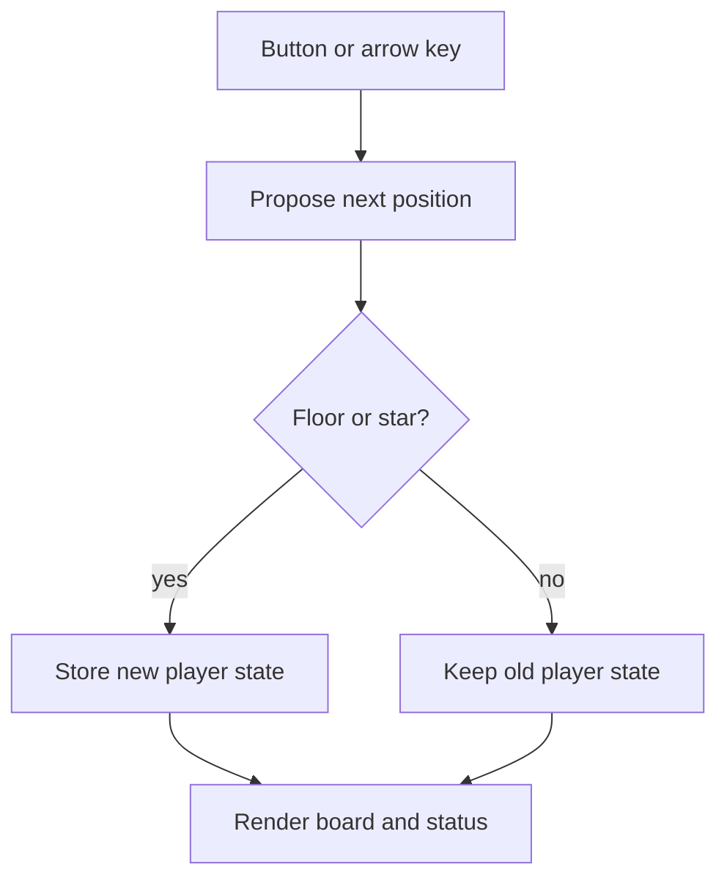

# Game state, transitions and rendering

## Keep the rule separate from the screen

A small browser game has a state, actions that may change it, and a rendering of that state. For a grid walker, state can be `{x: 1, y: 3}`. An action such as Right proposes a new coordinate. A transition function checks the rules and returns the next state. Rendering then converts that state into visible board text.

```javascript
function move(state, dx, dy, map) {
  const next = {x: state.x + dx, y: state.y + dy};
  return map[next.y]?.[next.x] && map[next.y][next.x] !== "#"
    ? next : state;
}
```

This reusable snippet needs a map argument and is not the complete game. It returns the unchanged state when the destination is outside the map or a wall. Keeping the rule independent of DOM elements lets you test movement without relying on a screenshot. A screen that appears unchanged might mean blocked movement, an event that never fired, or a renderer that failed; separate functions make those explanations easier to distinguish.

## From action to visible change

The working starter follows action → transition → render. Its board uses `textContent`, so map symbols are rendered as text rather than interpreted as HTML. The saved map is not changed when the player moves: rendering overlays `@` at the current coordinate. This distinction prevents a common bug where moving the player erases the tile underneath it.



## One transition and a blocked destination

From `(1,3)`, Right reaches `(2,3)`. Up from there is blocked by the wall at `(2,2)`, so the transition returns `(2,3)` unchanged. Replacing that wall with floor permits the next move to `(2,2)` without changing the movement function.

The [MDN DOM introduction](https://developer.mozilla.org/en-US/docs/Web/API/Document_Object_Model/Introduction) and [textContent reference](https://developer.mozilla.org/en-US/docs/Web/API/Node/textContent) explain the browser mechanisms. They are link-only references, not embedded excerpts.
